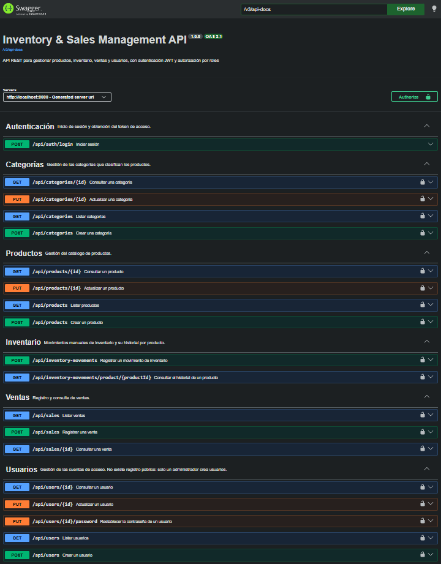

# Inventory & Sales Management API

REST API for a small business to manage products, inventory, sales and users, with JWT authentication and role-based access control. Built with Java 21, Spring Boot and PostgreSQL.



<details>
<summary><strong>Resumen en español</strong></summary>

API REST para que un pequeño negocio gestione productos, inventario, ventas y usuarios, con autenticación JWT y control de acceso por roles (`ADMIN` y `VENDEDOR`). El stock nunca se edita directamente: cambia solo mediante movimientos de inventario, y cada venta genera sus salidas dentro de una única transacción. Se levanta con un solo comando (`docker compose up --build`) y está cubierta con pruebas unitarias y de integración sobre un PostgreSQL real. La documentación interactiva (Swagger) y los mensajes de error de la API están en español.

</details>

## Highlights

- **Inventory traceability.** Stock is never edited directly. Every change is recorded as an inventory movement (`ENTRADA`, `SALIDA`, `AJUSTE`), and sales generate their own outgoing movements, so any stock figure can be explained.
- **Security and access control.** JWT authentication, BCrypt-hashed passwords and two roles (`ADMIN`, `VENDEDOR`) with per-operation permissions declared in a single place. Deactivating a user cuts their access immediately, even if their token has not expired.
- **Integrity and testing.** A sale and its inventory movements run in one transaction, so there are no partial operations. Unit tests (Mockito) cover business rules, and integration tests (Testcontainers) run against a real PostgreSQL to verify migrations, database constraints, HTTP permissions and transaction rollback.

## Tech stack

| Area | Technology |
|---|---|
| Language / framework | Java 21, Spring Boot 4, Spring Web, Spring Data JPA (Hibernate) |
| Database | PostgreSQL, schema versioned with Flyway |
| Security | Spring Security, JWT (JJWT), BCrypt |
| API documentation | OpenAPI / Swagger UI (springdoc) |
| Testing | JUnit 5, Mockito, AssertJ, Testcontainers |
| Packaging | Maven, Docker, Docker Compose |

## Run it with Docker

Requirements: Docker Desktop (or Docker Engine with Compose).

```bash
git clone https://github.com/ZahidGSJ/inventory-sales-api.git
cd inventory-sales-api
cp .env.example .env          # on PowerShell: Copy-Item .env.example .env
```

Edit `.env` and fill in the values below. Generate the JWT secret with `openssl rand -base64 32`.

| Variable | Purpose | Needed for Docker |
|---|---|---|
| `POSTGRES_PASSWORD` | Password of the PostgreSQL container | Yes |
| `JWT_SECRET` | Base64 key (at least 32 bytes) used to sign tokens | Yes |
| `ADMIN_EMAIL` | Email of the first administrator | Yes |
| `ADMIN_PASSWORD` | Password of the first administrator | Yes |
| `ADMIN_NAME` | Name of the first administrator | No (default: `Administrador`) |
| `DB_URL`, `DB_USERNAME`, `DB_PASSWORD` | Database connection when running **without** Docker | No |

Then start everything:

```bash
docker compose up --build
```

The API listens on `http://localhost:8080` and Swagger UI is at `http://localhost:8080/swagger-ui/index.html`. The first administrator is created on startup from `ADMIN_EMAIL` / `ADMIN_PASSWORD`; there is no public registration. Log in to get a token:

```bash
curl -X POST http://localhost:8080/api/auth/login \
  -H "Content-Type: application/json" \
  -d '{"email":"<ADMIN_EMAIL>","password":"<ADMIN_PASSWORD>"}'
```

Use the returned `accessToken` in the `Authorization: Bearer <token>` header, or click **Authorize** in Swagger UI. PostgreSQL is not published outside the Compose network. To remove containers and data: `docker compose down -v`.

## Run the tests

```bash
./mvnw test
```

Docker must be running: the integration tests start a disposable PostgreSQL container with Testcontainers.

## API overview

| Resource | Endpoints | Access |
|---|---|---|
| Authentication | `POST /api/auth/login` | Public |
| Categories | `GET /api/categories`, `GET /api/categories/{id}` | `ADMIN`, `VENDEDOR` |
| | `POST /api/categories`, `PUT /api/categories/{id}` | `ADMIN` |
| Products | `GET /api/products`, `GET /api/products/{id}` | `ADMIN`, `VENDEDOR` |
| | `POST /api/products`, `PUT /api/products/{id}` | `ADMIN` |
| Inventory movements | `POST /api/inventory-movements`, `GET /api/inventory-movements/product/{id}` | `ADMIN` |
| Sales | `POST /api/sales`, `GET /api/sales`, `GET /api/sales/{id}` | `ADMIN`, `VENDEDOR` |
| Users | `POST`, `GET`, `GET /{id}`, `PUT /{id}`, `PUT /{id}/password` under `/api/users` | `ADMIN` |

The source of truth for permissions is `SecurityConfig`; the interactive documentation lists request and response details. Documentation and error messages are in Spanish.

## Design decisions

- **Package by feature** (`product`, `sale`, `user`...) instead of by layer: everything about a domain lives together. Cross-cutting pieces (`security`, `exception`, `config`) have their own packages.
- **DTOs for input and output.** Entities are never exposed; creation and update use different request types where the rules differ (for example, a product's SKU cannot be changed after creation).
- **Flyway migrations with `ddl-auto=validate`.** The schema is versioned and reproducible; Hibernate only checks that the entities match it.
- **Sales are an aggregate.** The unit price is stored on each line at the moment of the sale, the total is computed on the server, and stock is validated against the sum of each product's quantities before any movement is registered.
- **Stateless JWT, user loaded on every request.** The token carries only the email and expiry; roles and status come from the database, so permission changes and deactivation take effect immediately.
- **Soft delete.** Products and users are deactivated, not deleted, to preserve history.
- **Consistent error contract.** A global exception handler maps business errors to a single `ErrorResponse` format with the right status code (400, 401, 403, 404, 409).
- **N+1 queries measured and fixed.** Listing sales went from 1 + N queries to one, using an entity graph.
- **Self-protection rules.** An administrator cannot deactivate their own account or change their own role, and at least one active administrator must always remain.
- **Uniqueness enforced by the database.** Category names and product SKUs are unique regardless of letter case, guaranteed by functional unique indexes; the service-level check only provides a clear error message.

## Project structure

```
src/main/java/com/zahid/inventoryapi
├── auth        login and JWT issuance
├── category
├── config      OpenAPI configuration
├── exception   global error handling
├── inventory   inventory movements
├── product
├── sale        sales and sale lines
├── security    security configuration and JWT filter
└── user        users, roles and first-administrator bootstrap
src/main/resources/db/migration   Flyway migrations
src/test                          unit and integration tests
```

## Known limitations and roadmap

- Tokens issued before a password reset stay valid until they expire (15 minutes by default); token revocation and refresh tokens are not implemented yet.
- API messages and documentation are in Spanish; internationalization is planned.
- Suppliers and a statistics dashboard are not implemented yet.
- Multi-branch support (stock per location) is a planned extension.